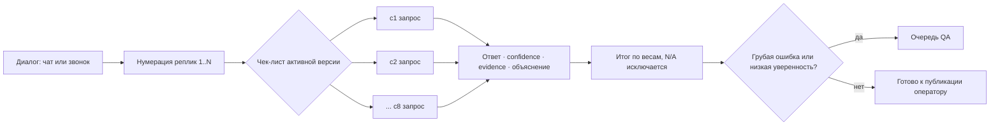
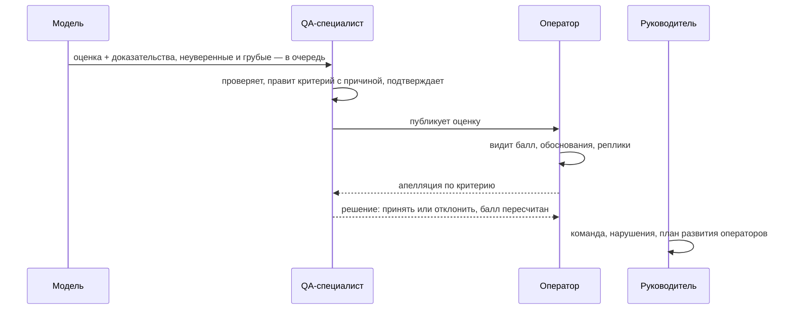

<a id="readme-top"></a>
<div align="center">

# CQA · контроль качества диалогов Freedom Broker

**Модель проверяет каждый чат и звонок по чек-листу QA: 91,7% совпадения с эталоном по критериям, $0,023 и ~6 секунд на диалог. Каждый ответ подкреплён номерами реплик.**


[Результаты](#results) · [Как это работает](#design) · [Запуск](#run) · [Сценарии демо](#demo) · [Формат сдачи](#submission) · [Ограничения](#limitations)

</div>

<details>
<summary>Содержание</summary>

- [Результаты на эталоне](#results)
- [Какую проблему решаем](#why)
- [Как работает оценка](#design)
- [Продукт: роли и процесс](#product)
- [Запуск](#run)
- [Сценарии для жюри](#demo)
- [Выгрузка результатов](#submission)
- [Путь версий](#ladder)
- [Что не сработало](#failed)
- [Структура репозитория](#structure)
- [Ограничения](#limitations)
- [Источники](#credits)

</details>

<a id="results"></a>
## Результаты на эталоне

Эталон — 15 диалогов DEV, размеченных вручную по [`docs/критерии_оценки.md`](docs/критерии_оценки.md):
RU, KZ и EN, чаты и звонки. Всего 120 решений по критериям. Модель — Claude Sonnet 5.5,
`effort: low`, один запрос на критерий.

| Метрика | Значение |
|---|---:|
| Точность по критериям (120 решений) | **91,7%** |
| Точность без спорных мест эталона (`unsure`) | **93,3%** |
| Средняя ошибка итогового балла (MAE, шкала 0–100) | **7,4** |
| Стоимость одного диалога | **$0,023** |
| Время одного диалога, среднее / максимум | **5,7 с / 8,9 с** |

| Критерий | Вес | Точность |
|---|---:|---:|
| c1 Установление контакта | 10 | 100% |
| c2 Выявление потребности | 15 | 86,7% |
| c3 Идентификация | 20 | 93,3% |
| c4 Корректная и полная консультация | 20 | 86,7% |
| c5 Эмпатия и клиентоориентированность | 15 | 100% |
| c6 Управление диалогом, скорость, грамотность | 15 | 73,3% |
| c7 Завершение | 5 | 93,3% |
| c8 Грубые ошибки (флаг без баллов) | — | **100%** |

Грубые ошибки модель находит без промахов на эталоне. Самый спорный критерий — c6:
шкала 10/7/4/0 субъективна, и там же больше всего расхождений между людьми.

[Прогон](runs/eval_1794055372.json) · [Расчёт стоимости](docs/экономика_модели.md) · [Скрипт сравнения](scripts/eval.py)

<a id="why"></a>
## Какую проблему решаем

QA-специалист вручную слушает или читает малую долю диалогов. Оценки разных проверяющих
расходятся, а оператор получает балл без объяснения и не может его оспорить.

| Боль | Что делает CQA |
|---|---|
| Проверяется выборка, грубые ошибки теряются | Модель оценивает **каждый** диалог, грубая ошибка сразу поднимает его в очередь |
| Балл без объяснения | По каждому критерию есть ответ, обоснование и **номера реплик-доказательств** |
| QA тратит время на очевидное | В очередь на проверку попадают только неуверенные ответы, грубые ошибки и выборка |
| Оператор не согласен и ему некуда идти | Апелляция по конкретному критерию с решением QA и историей |
| Чек-лист меняется, старые оценки устаревают | Версии чек-листа, пробный прогон, переоценка только изменённых критериев |

Подробнее: [пользователи и боли](docs/пользователи_и_боли.md), [конкуренты](docs/конкуренты.md),
[исследование продукта](docs/product_research.md).

<a id="design"></a>
## Как работает оценка



- **Один запрос на критерий.** Модель смотрит только на свой критерий, и нарушения
  других критериев её не сбивают. На одном и том же промпте это +4 п.п. точности и в 1,4 раза
  меньше ошибка балла против одного запроса на весь чек-лист (см. [путь версий](#ladder)).
- **Общий префикс в кеше.** Системный промпт и транскрипт одинаковы для всех восьми запросов,
  поэтому со второго запроса они читаются из prompt cache. Восемь запросов стоят всего в
  1,6 раза дороже одного.
- **Правила канала в промпте.** Боту и системе ошибки оператора не засчитываются. Работа
  оператора в чате начинается после события эскалации. В звонке шум распознавания, маски
  `[Имя скрыто]` и дубли реплик ошибкой не считаются.
- **Доказательства обязательны.** Каждый ответ — JSON с номерами реплик (нумерация с 1).
  Для пропущенного действия модель указывает реплики, где оно ожидалось.
- **Итоговый балл** = Σ(вес × доля балла) / Σ весов применимых критериев × 100. N/A исключается
  из знаменателя, c8 баллов не даёт и работает как флаг.
- **Переоценка без лишних трат.** У каждого критерия есть семантический хеш. После правки
  чек-листа переоцениваются только изменённые критерии, остальные ответы переиспользуются.

Ядро — [`scripts/cqa.py`](scripts/cqa.py): промпты, вызов модели, дерево условий, расчёт итога.
Фоновые задачи и сохранение по готовности — [`app/engine.py`](app/engine.py).

<a id="product"></a>
## Продукт: роли и процесс



| Роль | Что видит и делает |
|---|---|
| **QA** | Очередь проверки с причинами, карточка диалога (переписка слева, оценочный лист справа), правка ответа с причиной, апелляции, чек-листы, калибровка с эталоном, аналитика |
| **Оператор** | Свои оценки, разбор по критериям с цитатами, «Ознакомлен», «Оспорить» |
| **Руководитель** | Сводка по своей группе, нарушения, планы развития операторов |
| **Админ** | Пользователи, модель (Sonnet или Haiku), порог уверенности, бюджет API, журнал действий |

Карточка диалога сделана по образцу Observe.AI AutoQA. Клик по критерию подсвечивает
реплики-доказательства в переписке, клик по метке у реплики открывает критерий.

**Чек-лист — это данные, а не код.** Критерии, веса, допустимые ответы и правила лежат в
[`config/checklists/chat.v1.json`](config/checklists/chat.v1.json) и в базе. Критерий можно
добавить, изменить или перевесить в интерфейсе, проверить пробным прогоном на эталоне,
опубликовать новой версией и применить к диалогам.

<a id="run"></a>
## Запуск

Нужны Python 3.12+, PostgreSQL 15+ и ключ Anthropic API.

```bash
git clone https://github.com/BDaaac/Data-Challenge.git
cd Data-Challenge
python -m venv .venv
.venv/Scripts/activate            # Linux/macOS: source .venv/bin/activate
pip install -r requirements.txt
```

Файл `.env` в корне (в Git не попадает):

```text
ANTHROPIC_API_KEY=sk-ant-...
DATABASE_URL=postgresql://cqa@localhost:5433/cqa   # необязательно, это значение по умолчанию
DEMO_PASSWORD=freedom2026                          # необязательно
```

Локальная база на порту 5433:

```bash
initdb -D .pgdata -U cqa --auth=trust
pg_ctl -D .pgdata -o "-p 5433" -l runs/pg.log start
createdb -h localhost -p 5433 -U cqa cqa
```

Наполнение и сервер:

```bash
python -m app.seed                 # пользователи, чек-лист v1, 65 диалогов DEV, сохранённые оценки эталона
python -m uvicorn app.main:app --port 8000
```

Откройте http://localhost:8000. На экране входа можно выбрать демо-роль без пароля.
`seed` не обращается к API: оценки эталона берутся из сохранённого прогона
[`runs/eval_1794055372.json`](runs/eval_1794055372.json). Вызовы модели начинаются, когда вы
сами запускаете оценку. Бюджет ограничен в настройках (по умолчанию $20).

`python -m app.seed --reset` удаляет все данные и наполняет базу заново.

<a id="demo"></a>
## Сценарии для жюри

| Просьба жюри | Где показать |
|---|---|
| Диалоги с грубыми ошибками и объяснения | QA → «Нарушения» или фильтр очереди. В карточке c8 выбран сразу, переписка прокручена к доказательству |
| Результат конкретного диалога с обоснованием | Поиск по ID, например `p1-ru-022`. Итог, оценка по каждому критерию, «Основание», реплики-доказательства, паспорт оценки (модель, стоимость, время, версия промпта) |
| Апелляция оператора | Войти оператором → свой диалог → «Оспорить» по критерию. Затем QA → «Апелляции» → решение. Балл пересчитывается, событие попадает в историю |
| Изменение чек-листа | QA → «Чек-листы» → черновик: добавить критерий, изменить правило, поменять вес → пробный прогон → опубликовать → применить |
| Самостоятельная работа | Демо-роли на экране входа, без пароля |

<a id="submission"></a>
## Выгрузка результатов

Формат — JSON 1.0 из гайда организаторов. Нумерация реплик в `evidence_turns` с 1.

```bash
python scripts/export_results.py --set dev  --input data/dev.json
python scripts/export_results.py --set prod --input data/prod.json
python scripts/submission.py results/prod/results.json --input data/prod.json --set prod
```

Каждый оценённый диалог сразу кешируется в `runs/export/<set>/`. После сбоя достаточно
повторить ту же команду: дооцениваются только упавшие и новые диалоги. `submission.py`
проверяет схему, коды критериев, допустимые значения и полноту набора. Из интерфейса
выгрузка доступна через `GET /api/export/results.json`.

<a id="ladder"></a>
## Путь версий

Все прогоны на одном эталоне из 15 диалогов, Sonnet 5.5, `effort: low`.

| Версия | Подход | Точность | MAE балла | $/диалог |
|---|---|---:|---:|---:|
| single | 1 запрос на весь чек-лист | 74,2% | 20,3 | 0,014 |
| recheck | single + перепроверка неуверенных критериев | 75,8% | 17,2 | 0,022 |
| criterion v1 | 1 запрос на критерий | 78,3% | 14,6 | 0,022 |
| criterion v2 | + правила в промпте по разбору ошибок v1 | 90,8% | 9,3 | 0,019 |
| **criterion v3** | **+ следующая итерация правил** | **91,7%** | **7,4** | **0,023** |

Прирост дали не дорогая модель и не голосование, а точные правила в промпте. Сейчас там
сказано, где начинается работа оператора, что не считается ошибкой в звонке и где проходит
граница между критериями ([`scripts/cqa.py`](scripts/cqa.py), разбор расхождений —
[`runs/diffs.txt`](runs/diffs.txt)).

<a id="failed"></a>
## Что не сработало

| Гипотеза | Результат | Вывод |
|---|---|---|
| Один запрос на весь чек-лист | 74%, MAE 20 | Нарушение одного критерия «перетекает» в соседние |
| Перепроверка неуверенных ответов голосованием | +1,6 п.п. за +57% цены и ×2 времени | Шум не убирает, если правило в промпте нечёткое |
| Haiku 5.5 вместо Sonnet | В ~10 раз дешевле, но на пробных диалогах ошибается в эмпатии, завершении и шкалах. На эталоне не мерили | Модель выбирается в настройках, по умолчанию Sonnet |
| Первая прикидка $0,10 за диалог | Фактически $0,023 | При `effort: low` и кеше префикса модель рассуждает меньше |

<a id="structure"></a>
## Структура репозитория

```text
app/                    FastAPI: API, роли, движок фоновой оценки, схема БД, наполнение
  main.py               эндпоинты /api/*
  engine.py             задачи оценки, переиспользование, итог, бюджет
  schema.sql            таблицы: dialogs, evaluations, eval_items, appeals, checklists, ...
  seed.py               демо-данные
scripts/
  cqa.py                ядро: промпты, вызов модели, расчёт итога
  eval.py               сравнение подходов на эталоне
  export_results.py     оценка набора и выгрузка results.json
  submission.py         сборка и проверка формата сдачи
config/checklists/      чек-лист как данные
data/dev.json           диалоги DEV
eval/gold.json          эталонная разметка 15 диалогов
web/                    интерфейс: vanilla JS (ES-модули) и CSS, без сборки
docs/                   критерии, пользователи, конкуренты, экономика модели
runs/                   прогоны эталона и кеш выгрузки
```

<a id="limitations"></a>
## Ограничения

- Эталон маленький: 15 диалогов, 120 решений. Разница в 1–2 п.п. между версиями лежит в
  пределах шума.
- Эталон размечен по документу критериев без просмотра ответов модели, но **одним
  разметчиком**. Спорные места помечены `unsure` в [`eval/gold.json`](eval/gold.json).
  Нужна независимая проверка командой или QA Freedom.
- Звонков в DEV всего 5. Качество на распознанной речи проверено слабее, чем на чатах.
- c6 (скорость и грамотность) остаётся самым субъективным критерием, точность 73%.
- Модель внешняя (Anthropic API): транскрипты уходят за периметр. Для продакшена в банке
  нужен договор о данных или локальная модель. Интерфейс модели изолирован в `scripts/cqa.py`.
- Демо-вход без пароля сделан для показа. В рабочей установке его нужно отключить.

<a id="credits"></a>
## Источники

- Чек-лист и формат сдачи — материалы организаторов Data Challenge Freedom Broker.
- [Claude API](https://docs.claude.com/): Messages API, prompt caching, `effort`.
- [Observe.AI AutoQA](https://www.observe.ai/): образец связки «вопрос → ответ → доказательство»
  для карточки диалога.
- [FastAPI](https://fastapi.tiangolo.com/), [PostgreSQL](https://www.postgresql.org/),
  шрифт [Geist](https://vercel.com/font).
- [Best-README-Template](https://github.com/othneildrew/Best-README-Template): основа структуры README.

<p align="right"><a href="#readme-top">Наверх ↑</a></p>
